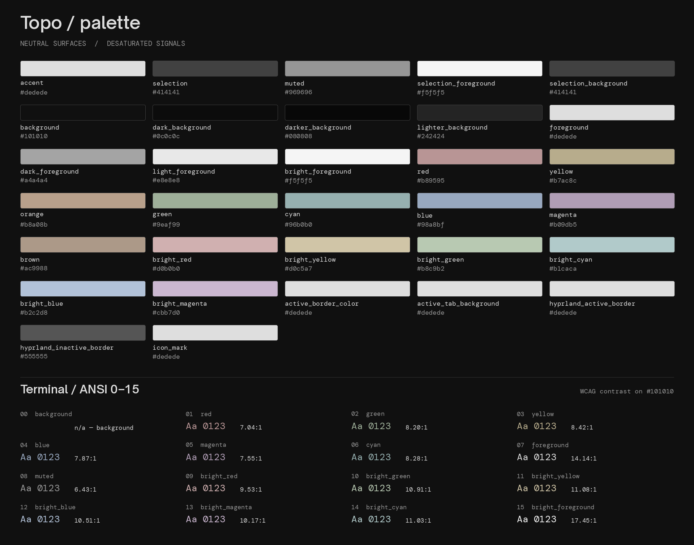
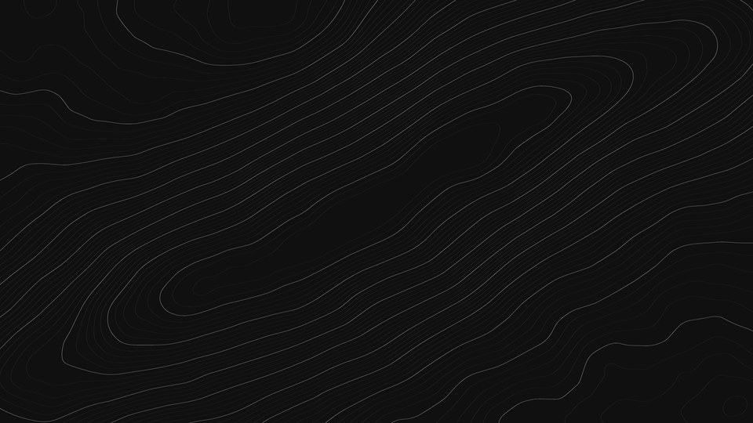
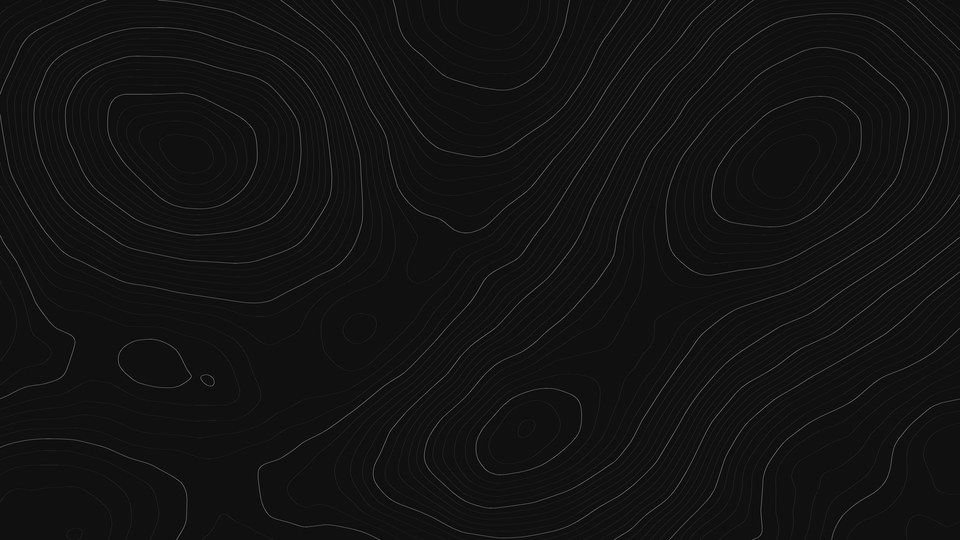
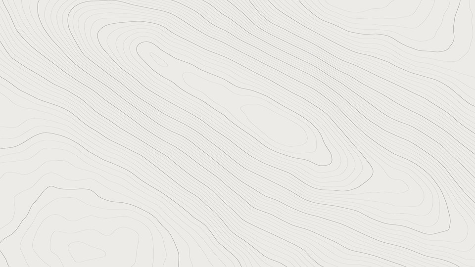
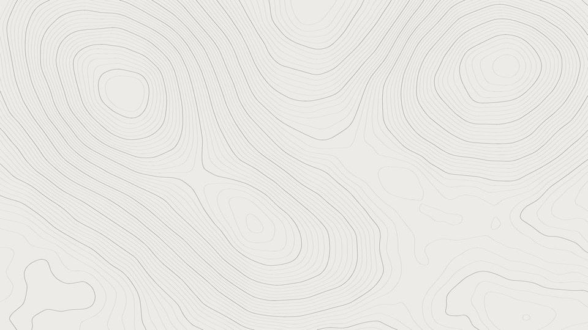
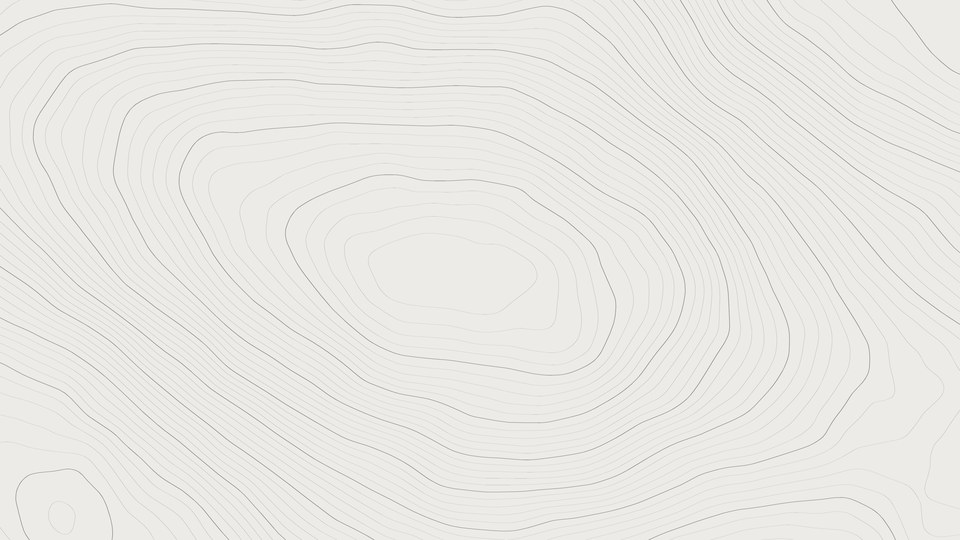

# Topo

A dark Omarchy / Hyprland theme inspired by topographic contour maps. Near-black surfaces, light grey text, and softly desaturated terminal colours keep the desktop quiet and readable. Six original 4K wallpapers trace ridges, scattered peaks, and basins in dark graphite or warm off-white.


## Install

```sh
omarchy-theme-install https://github.com/Jsmith8778/omarchy-topo-theme
```

Omarchy derives the theme name **topo** from the repository name. The default bundled wallpaper is `1-topo-dark-ridge.png`. Background paths are sorted; a previously saved selection or a custom background can take precedence. The light wallpapers are alternatives within the same **dark** application theme.

## Palette



`mode = "dark"`. Neutral surfaces and accents surround low-chroma ANSI colours, so syntax and terminal signals remain distinguishable. Bright variants are lighter versions of the same hues. ANSI black is the background; ANSI bright black is `muted`, which remains readable as comment text.

| Key | Hex |
| --- | --- |
| `accent` | `#dedede` |
| `selection` | `#414141` |
| `muted` | `#969696` |
| `selection_foreground` | `#f5f5f5` |
| `selection_background` | `#414141` |
| `background` | `#101010` |
| `dark_background` | `#0c0c0c` |
| `darker_background` | `#080808` |
| `lighter_background` | `#242424` |
| `foreground` | `#dedede` |
| `dark_foreground` | `#a4a4a4` |
| `light_foreground` | `#e8e8e8` |
| `bright_foreground` | `#f5f5f5` |
| `red` | `#b89595` |
| `yellow` | `#b7ac8c` |
| `orange` | `#b8a08b` |
| `green` | `#9eaf99` |
| `cyan` | `#96b0b0` |
| `blue` | `#98a8bf` |
| `magenta` | `#b09db5` |
| `brown` | `#ac9988` |
| `bright_red` | `#d0b0b0` |
| `bright_yellow` | `#d0c5a7` |
| `bright_green` | `#b8c9b2` |
| `bright_cyan` | `#b1caca` |
| `bright_blue` | `#b2c2d8` |
| `bright_magenta` | `#cbb7d0` |
| `active_border_color` | `#dedede` |
| `active_tab_background` | `#dedede` |
| `hyprland_active_border` | `#dedede` |
| `hyprland_inactive_border` | `#555555` |
| `icon_mark` | `#dedede` |

## Wallpapers

Every PNG is **3840 × 2160**. Each image links to the full wallpaper; its editable vector counterpart is in `src/`. Sizes below are exact bytes. The JPEG thumbnails are 960 × 540.

| Wallpaper | Preview | PNG bytes | SVG bytes |
| --- | --- | ---: | ---: |
| **1-topo-dark-ridge** | [](backgrounds/1-topo-dark-ridge.png) | 732,383 | 121,530 |
| **2-topo-dark-peaks** | [](backgrounds/2-topo-dark-peaks.png) | 835,321 | 137,996 |
| **3-topo-dark-basin** | [](backgrounds/3-topo-dark-basin.png) | 713,276 | 118,502 |
| **4-topo-light-ridge** | [](backgrounds/4-topo-light-ridge.png) | 560,695 | 106,468 |
| **5-topo-light-peaks** | [](backgrounds/5-topo-light-peaks.png) | 733,132 | 165,671 |
| **6-topo-light-basin** | [](backgrounds/6-topo-light-basin.png) | 518,627 | 98,654 |

## Contrast

The following is the validator's WCAG relative-luminance contrast table, using the upstream resolver's actual ANSI mappings. The minimum is 4.5:1 for text, accent, muted, and ANSI 1–15. Topo additionally enforces 12:1 for foreground and 7:1 for the explicit selection pair. ANSI 0 is intentionally the background and is not treated as readable text. Wallpaper lines and inactive borders are decorative and are outside the text contrast check.

| Role | Foreground | Background | Contrast | Minimum | Result |
| --- | --- | --- | ---: | ---: | --- |
| fg | #dedede | #101010 | 14.14:1 | 12.0:1 | PASS |
| muted | #969696 | #101010 | 6.43:1 | 4.5:1 | PASS |
| selection | #f5f5f5 | #414141 | 9.36:1 | 7.0:1 | PASS |
| accent | #dedede | #101010 | 14.14:1 | 4.5:1 | PASS |
| ANSI 0 (background) | #101010 | #101010 | n/a | n/a | background |
| ANSI 1 (red) | #b89595 | #101010 | 7.04:1 | 4.5:1 | PASS |
| ANSI 2 (green) | #9eaf99 | #101010 | 8.20:1 | 4.5:1 | PASS |
| ANSI 3 (yellow) | #b7ac8c | #101010 | 8.42:1 | 4.5:1 | PASS |
| ANSI 4 (blue) | #98a8bf | #101010 | 7.87:1 | 4.5:1 | PASS |
| ANSI 5 (magenta) | #b09db5 | #101010 | 7.55:1 | 4.5:1 | PASS |
| ANSI 6 (cyan) | #96b0b0 | #101010 | 8.28:1 | 4.5:1 | PASS |
| ANSI 7 (foreground) | #dedede | #101010 | 14.14:1 | 4.5:1 | PASS |
| ANSI 8 (muted) | #969696 | #101010 | 6.43:1 | 4.5:1 | PASS |
| ANSI 9 (bright_red) | #d0b0b0 | #101010 | 9.53:1 | 4.5:1 | PASS |
| ANSI 10 (bright_green) | #b8c9b2 | #101010 | 10.91:1 | 4.5:1 | PASS |
| ANSI 11 (bright_yellow) | #d0c5a7 | #101010 | 11.08:1 | 4.5:1 | PASS |
| ANSI 12 (bright_blue) | #b2c2d8 | #101010 | 10.51:1 | 4.5:1 | PASS |
| ANSI 13 (bright_magenta) | #cbb7d0 | #101010 | 10.17:1 | 4.5:1 | PASS |
| ANSI 14 (bright_cyan) | #b1caca | #101010 | 11.03:1 | 4.5:1 | PASS |
| ANSI 15 (bright_foreground) | #f5f5f5 | #101010 | 17.45:1 | 4.5:1 | PASS |

## Generate the artwork

Use Python 3.13 with NumPy and Pillow already available. No renderer, font download, or additional package is needed.

```sh
python3 tools/generate_wallpapers.py
python3 tools/generate_previews.py
```

`tools/generate_wallpapers.py` builds each scalar field on the full 3840 × 2160 grid from rotated Gaussian hills and valleys plus four octaves of smooth value noise. Quintic interpolation avoids hard lattice edges. Hand-written NumPy marching squares extracts original iso-lines; a bilinear saddle decider and shared edge identifiers keep the lines connected. Ramer–Douglas–Peucker simplification, two Chaikin smoothing passes, and a final simplification produce compact polylines with one-decimal coordinates.

The same polylines are grouped into SVG minor/index strokes and rendered with Pillow ImageDraw at **7680 × 4320**, then downsampled with LANCZOS. Minor contours are 1 px wide at final size; every fifth elevation is a 2 px index contour. Dark strokes are `#3d3d3d` / `#858585` on `#101010`. Light strokes are `#b1b0ae` / `#858482` on `#ecebe8`. Dark PNGs use lossless 8-bit luminance; light PNGs use an exact 256-entry near-neutral ramp, without palette dithering. PNG optimization is lossless.

| Design | Fixed seed | Elevation levels |
| --- | ---: | ---: |
| Dark ridge | 2701 | 52 |
| Dark peaks | 2702 | 43 |
| Dark basin | 2703 | 60 |
| Light ridge | 2704 | 47 |
| Light peaks | 2705 | 56 |
| Light basin | 2706 | 50 |

Light variants also change the Gaussian positions and orientations. To regenerate just one terrain:

```sh
python3 tools/generate_wallpapers.py --only 1-topo-dark-ridge
```

`tools/generate_previews.py` reads the palette, creates all colour swatches and terminal samples, downsizes the six wallpapers, and draws the desktop and unlock mockups. The contour-ring emblem is original procedural geometry. `unlock.png` is **800 × 188 RGBA**, with genuine transparency and a light-grey wordmark, matching upstream's shorter logo convention. The desktop image is 2560 × 1440 and the unlock image is 1920 × 1080.

The two screen previews are illustrative Pillow mockups with synthetic text, not live screenshots. The lock/boot mock uses the wallpaper for presentation; Plymouth itself uses the selected solid background, text colour, and transparent logo. Existing system fonts are selected in a fixed preference order: Geist, DM Mono, and Open Sauce Sans, with DejaVu and Pillow defaults as fallbacks. Font files are not embedded. Regeneration is byte-identical with the same library and font versions; different system fonts can change the preview text.

## Validate

```sh
git clone --depth 1 https://github.com/basecamp/omarchy.git ../omarchy
python3 tools/validate.py --upstream ../omarchy
```

The validator inventories every bundled upstream theme, parses the installed-theme deny list from upstream, and reports the union and strict intersection of allowed files. It checks all repository TOML, CSS, and INI files, every upstream palette key, resolved contrast, image dimensions and limits, SVG pairs, and literal email/hostname patterns. Bash plus the upstream colour resolver supplies the actual palette; if unavailable, it reports a raw-palette fallback. Malformed or incomplete resolver output fails validation.

The scan covers published text, filenames, and image metadata. Git internals, workspace-owned metadata directories, and ignored Python caches are excluded. Python strings and comments are scanned without mistaking attribute expressions for hostnames; ordinary file extensions are distinguished from domains. SVG namespace dots use XML character references, preserving the standard SVG namespace without a literal external hostname. README URLs and the designated GitHub owner path are the only URL exceptions. The simple pattern scan is a sanity check, not a proof that arbitrary data can never contain personal information.

[Complete validator output](VALIDATION.md#complete-validator-output), [exact file sizes, and review notes](VALIDATION.md) record the generated repository's checks.

## Upstream compatibility

Validated against the read-only Omarchy source at commit **`ecd8a5324ae5668695d4b8cd3a0bd4fe8c7bdf23`**. This repository uses the current **templated `colors.toml` format**. Omarchy generates application configurations from the semantic palette at theme activation; Topo supplies no hand-written application configuration and no Lua files. The five extra optional palette roles used by other bundled themes are also included as neutral hex colours.

At this commit, git-installed themes drop `alacritty.toml`, `foot.ini`, `ghostty.conf`, `kitty.conf`, `vscode.json`, and Lua files. The validator reads the actual deny list rather than fixing this list in code. No denied file is shipped here. `chromium.theme` contains `16,16,16`, matching the theme background. A custom `btop.theme` adds no value over upstream's palette-driven template, so it is omitted.

There are 23 bundled themes in the reference checkout. `colors.toml` and `preview.png` occur in all 23; `preview-unlock.png` and `unlock.png` occur in 22, with `starship` the exception. Topo includes all four plus the requested browser frame colour and six wallpapers. Optional keyboard, shell-lock, and btop overrides are left to the upstream templates. Upstream's `omarchy-plymouth-set` consumes the transparent logo and separate background/text colours; it does not install a wallpaper as the boot screen.

Compatibility checks inspect source and execute the read-only colour resolver; a running Hyprland/Plymouth session was not available for a live installation test.

## License

[MIT](LICENSE). Copyright (c) 2026 Jsmith8778.

All wallpapers, vector sources, contour-ring artwork, and mockups are original, procedurally generated, and MIT-licensed alongside the scripts and palette. No existing artwork was copied.
