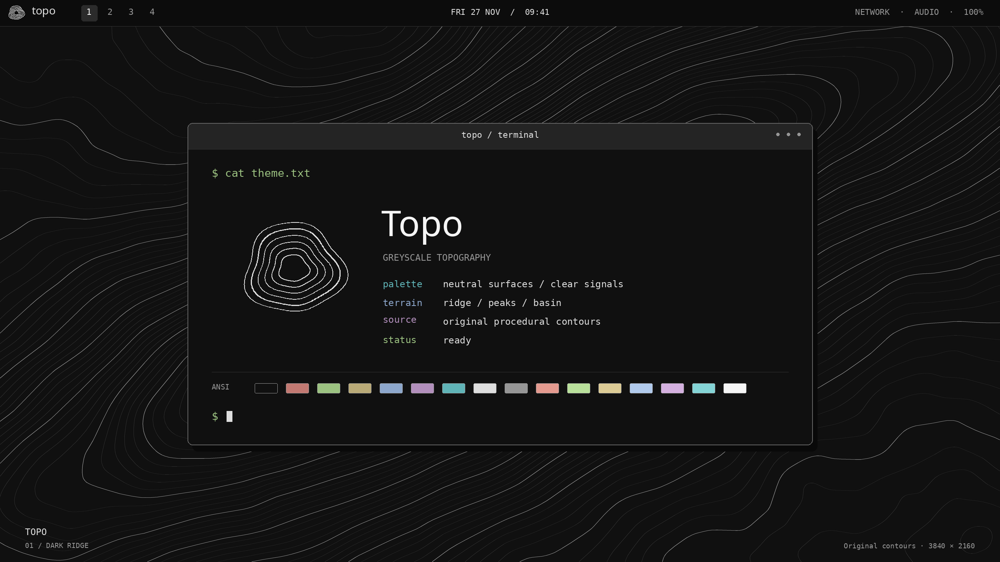
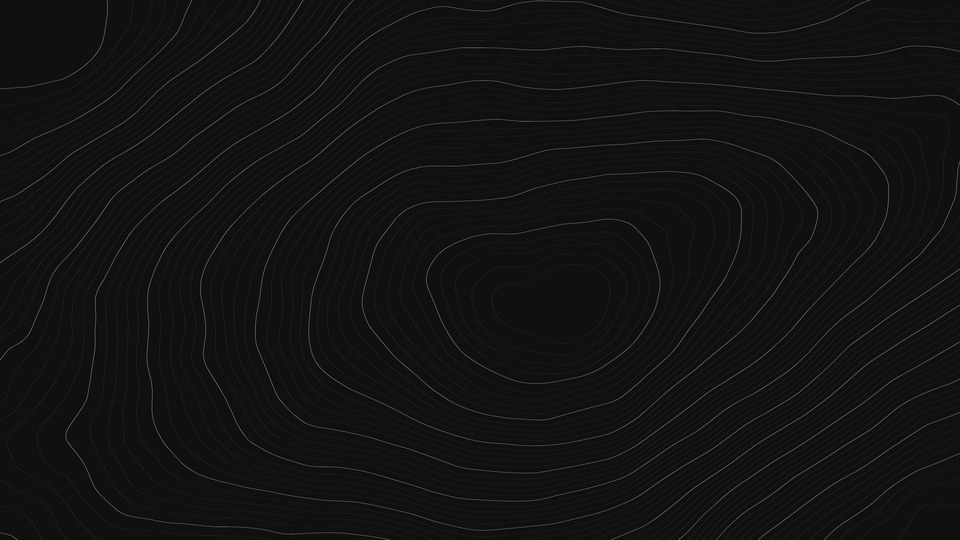

# Topo

A dark Omarchy / Hyprland theme inspired by topographic contour maps. Near-black surfaces, light-grey text, and coloured terminal signals keep the desktop readable. Three original 3840 × 2160 wallpapers trace ridges, peaks, and a basin.



## Install

```sh
omarchy-theme-install https://github.com/Jsmith8778/omarchy-topo-theme
```

Omarchy derives the theme name **topo** from the repository name. The default wallpaper is `1-topo-dark-ridge.png`; a saved selection or custom background can take precedence. The separate [topo-light theme](https://github.com/Jsmith8778/omarchy-topo-light-theme) contains the other variant.

## Palette


`mode = "dark"`. Surface roles stay neutral. Bright ANSI entries are lighter versions of their normal hues. Red, green, and cyan carry clearer chroma; yellow, blue, and magenta retain muted but distinct hues. ANSI 0 is the background and ANSI 8 is readable `muted` text.

| Key | Hex |
| --- | --- |
| `accent` | `#dedede` |
| `selection` | `#2b2b2b` |
| `muted` | `#969696` |
| `selection_foreground` | `#f5f5f5` |
| `selection_background` | `#2b2b2b` |
| `background` | `#101010` |
| `dark_background` | `#0c0c0c` |
| `darker_background` | `#080808` |
| `lighter_background` | `#242424` |
| `foreground` | `#dedede` |
| `dark_foreground` | `#a4a4a4` |
| `light_foreground` | `#e8e8e8` |
| `bright_foreground` | `#f5f5f5` |
| `red` | `#c27972` |
| `yellow` | `#b9aa77` |
| `orange` | `#c29c72` |
| `green` | `#9cc281` |
| `cyan` | `#60b4b7` |
| `blue` | `#8da7cc` |
| `magenta` | `#b28fbc` |
| `brown` | `#a78973` |
| `bright_red` | `#e49a8f` |
| `bright_yellow` | `#dccb95` |
| `bright_green` | `#b9e09b` |
| `bright_cyan` | `#84d4d6` |
| `bright_blue` | `#b1caec` |
| `bright_magenta` | `#d4b0df` |
| `hyprland_inactive_border` | `#626262` |

## Contrast and colour separation

Upstream's look check requires **foreground at least 7:1**, and **accent, dark_foreground, red, green, yellow, and blue at least 3:1** against background (`bin/omarchy-agent-look-theme:68`). It also requires foreground on selection at least 4.5:1 (`:73-74`). We enforce **4.5:1 on every ANSI 1–15**, foreground and muted; foreground also meets upstream's stricter 7:1 bar. Explicit selection foreground, ordinary foreground, and muted all meet 4.5:1 on selection. ANSI 0 intentionally equals background and is exempt. The retained inactive border meets 3:1.

All rows below pass. Ratios use WCAG sRGB relative luminance; the validator checks the actual mappings returned by upstream's colour resolver.

| Role | Colour | Background | Contrast | Minimum |
| --- | --- | --- | ---: | ---: |
| fg | `#dedede` | `#101010` | 14.14:1 | 7:1 |
| muted | `#969696` | `#101010` | 6.43:1 | 4.5:1 |
| accent | `#dedede` | `#101010` | 14.14:1 | 3:1 |
| dark_foreground | `#a4a4a4` | `#101010` | 7.63:1 | 3:1 |
| selection pair | `#f5f5f5` | `#2b2b2b` | 12.99:1 | 4.5:1 |
| foreground on selection | `#dedede` | `#2b2b2b` | 10.52:1 | 4.5:1 |
| muted on selection | `#969696` | `#2b2b2b` | 4.79:1 | 4.5:1 |
| inactive border | `#626262` | `#101010` | 3.12:1 | 3:1 |
| ANSI 1 (red) | `#c27972` | `#101010` | 5.68:1 | 4.5:1 |
| ANSI 2 (green) | `#9cc281` | `#101010` | 9.47:1 | 4.5:1 |
| ANSI 3 (yellow) | `#b9aa77` | `#101010` | 8.23:1 | 4.5:1 |
| ANSI 4 (blue) | `#8da7cc` | `#101010` | 7.73:1 | 4.5:1 |
| ANSI 5 (magenta) | `#b28fbc` | `#101010` | 6.84:1 | 4.5:1 |
| ANSI 6 (cyan) | `#60b4b7` | `#101010` | 7.89:1 | 4.5:1 |
| ANSI 7 (foreground) | `#dedede` | `#101010` | 14.14:1 | 4.5:1 |
| ANSI 8 (muted) | `#969696` | `#101010` | 6.43:1 | 4.5:1 |
| ANSI 9 (bright_red) | `#e49a8f` | `#101010` | 8.44:1 | 4.5:1 |
| ANSI 10 (bright_green) | `#b9e09b` | `#101010` | 12.87:1 | 4.5:1 |
| ANSI 11 (bright_yellow) | `#dccb95` | `#101010` | 11.80:1 | 4.5:1 |
| ANSI 12 (bright_blue) | `#b1caec` | `#101010` | 11.35:1 | 4.5:1 |
| ANSI 13 (bright_magenta) | `#d4b0df` | `#101010` | 10.04:1 | 4.5:1 |
| ANSI 14 (bright_cyan) | `#84d4d6` | `#101010` | 11.21:1 | 4.5:1 |
| ANSI 15 (bright_foreground) | `#f5f5f5` | `#101010` | 17.45:1 | 4.5:1 |

CIELAB uses sRGB, D65 and the 2° observer; C* is chroma and L* is lightness. Both normal and bright red/green must have C* ≥25, cyan C* ≥20. Green is brighter than red by at least 1.4× in relative luminance, without the WCAG +0.05 offset. ΔE76 values are descriptive, not a guarantee of colour-vision accessibility; luminance provides another distinguishing cue.

| Role | Hex | L* | C* | Minimum C* |
| --- | --- | ---: | ---: | ---: |
| red | `#c27972` | 58.38 | 31.91 | 25 |
| green | `#9cc281` | 74.34 | 37.67 | 25 |
| cyan | `#60b4b7` | 68.42 | 26.37 | 20 |
| bright_red | `#e49a8f` | 70.59 | 31.40 | 25 |
| bright_green | `#b9e09b` | 84.99 | 38.76 | 25 |
| bright_cyan | `#84d4d6` | 80.09 | 25.48 | 20 |
| yellow | `#b9aa77` | 69.75 | 28.37 | — |
| bright_yellow | `#dccb95` | 81.89 | 29.21 | — |
| blue | `#8da7cc` | 67.77 | 21.79 | — |
| bright_blue | `#b1caec` | 80.54 | 19.59 | — |
| magenta | `#b28fbc` | 63.95 | 28.16 | — |
| bright_magenta | `#d4b0df` | 76.30 | 28.36 | — |
| orange | `#c29c72` | 66.87 | 28.61 | — |
| brown | `#a78973` | 59.29 | 17.99 | — |

| Pair | Green / red relative luminance | Minimum |
| --- | ---: | ---: |
| normal | 1.792 | 1.4 |
| bright | 1.587 | 1.4 |

| Pair | ΔE76 |
| --- | ---: |
| red / bright_red | 12.34 |
| green / bright_green | 10.71 |
| yellow / bright_yellow | 12.17 |
| blue / bright_blue | 12.98 |
| magenta / bright_magenta | 12.35 |
| cyan / bright_cyan | 11.71 |
| orange / brown | 13.57 |

## Wallpapers

All PNGs are **3840 × 2160**, below 5 MB each. Matching vector sources live in `src/`; JPEG thumbnails and the palette preview are **960 × 540**. Sizes are exact bytes after regeneration.

| Wallpaper | PNG bytes | SVG bytes | JPEG bytes |
| --- | ---: | ---: | ---: |
| [](backgrounds/1-topo-dark-ridge.png) **1-topo-dark-ridge** | 732,383 | 121,522 | 89,909 |
| [](backgrounds/2-topo-dark-peaks.png) **2-topo-dark-peaks** | 835,321 | 137,988 | 85,332 |
| [](backgrounds/3-topo-dark-basin.png) **3-topo-dark-basin** | 713,276 | 118,494 | 85,688 |

## Generate

Python 3.11+ with NumPy and Pillow already available is sufficient. No artwork download is needed.

```sh
python3 tools/generate_wallpapers.py
python3 tools/generate_previews.py
```

The wallpaper generator builds a complete scalar field from rotated Gaussian hills and four octaves of quintic-interpolated value noise. Marching squares, an asymptotic saddle decider, shared edge IDs, Ramer–Douglas–Peucker simplification and two Chaikin passes produce smooth original polylines. The same one-decimal coordinates feed SVG paths and a 2× Pillow render, downsampled with Lanczos. Every fifth contour is an index line: 1 px minor / 2 px index at final resolution, using `#3d3d3d` / `#858585` on `#101010`. PNGs use lossless 8-bit luminance.

| Terrain | Fixed seed | Elevation levels |
| --- | ---: | ---: |
| ridge | 2701 | 52 |
| peaks | 2702 | 43 |
| basin | 2703 | 60 |

Only this repository's three designs are generated. The light design definitions have moved to the separate light repository. Regenerated wallpaper PNGs match their original bytes. SVG geometry is unchanged; the namespace is now the plain `http://www.w3.org/2000/svg` URL. Use `--only 1-topo-dark-ridge` to regenerate one design.

Previews use system fonts resolved through `fc-match`, falling back to Pillow's default font. Font files are not bundled; text can change with the system font and Pillow versions. The desktop (**2560 × 1440**) and unlock (**1920 × 1080**) previews are illustrative Pillow mockups with synthetic text. `unlock.png` is **800 × 188 RGBA**, with a light-grey contour emblem and wordmark. Plymouth copies this logo unchanged and uses separate solid background/text colours (`bin/omarchy-plymouth-set:274`, `:281-292`); the wallpaper in the unlock mock is for presentation.

## Validate

The recorded upstream commit is **`cbd7139ac67b8ef421cf828507ac6f59e02c7c9b`**. For a fresh checkout:

```sh
git clone https://github.com/basecamp/omarchy.git ../omarchy
git -C ../omarchy checkout cbd7139ac67b8ef421cf828507ac6f59e02c7c9b
python3 tools/validate.py --upstream ../omarchy
```

Validation runs offline against that checkout. It inventories bundled files, parses the installed-theme deny list, checks palette/config syntax, resolves colours through upstream, checks contrast/chroma, image dimensions, source pairs and public-file privacy, then runs the unmodified upstream look checker. The inventory is an observation of bundled files, not an installation allowlist.

If real `magick` is on PATH it is used. Otherwise the validator prepends `tools/magick_shim`, whose Pillow implementation supports only the look checker's image statistics and first-background crop. Its rendered output omits the drawing/annotation operations; it is not an ImageMagick desktop-render equivalence test. The current run used **the Pillow shim**, with upstream exit 0 and `problems: none`.

```text
PASS topo validation: 43 checks passed, 0 failed.
Upstream look: exit 0; backgrounds: 3; problems: none
Image statistics/render backend: tools/magick_shim/magick (Pillow)
```

[Fresh output, wallpaper sizes and validation limits](VALIDATION.md) record the result. Public-file scanning covers filenames, text, Python comments/string literals, and decoded image metadata. It excludes git/environment/cache metadata and recognizes ordinary file suffixes. The only URL exceptions are exactly the W3C SVG namespace and, in Markdown docs, GitHub URLs under `Jsmith8778` or `basecamp/omarchy`. Other email/hostname-like text and absolute machine paths are rejected. This pattern scan is a sanity check, not a proof about arbitrary data or historical commits.

## Upstream compatibility

The semantic `colors.toml` format drives Omarchy's generated application configs. No legacy `light.mode`, application configs or Lua files are shipped. Git-installed themes exclude top-level Lua files and `INSTALLED_THEME_DENIED` entries (`bin/omarchy-theme-set:36`, `:276-286`). `chromium.theme` is `16,16,16`, matching the background.

`icon_mark` is omitted so `bin/omarchy-theme-icon-palette:186-193` derives it. The unused `active_border_color` and `active_tab_background` keys and redundant `hyprland_active_border` override are absent. `hyprland_inactive_border` is retained because `default/themed/hyprland.lua.tpl:2` consumes it for the borders at `:8` and `:15`.

### Installed size

At the pinned commit, `bin/omarchy-theme-set:354` says `for entry in "$source"/*; do`; `:358` skips symlinks and denied top-level names; `:363-364` recurses with `stage_installed_dir "$entry" "$NEXT_THEME_PATH/$name"`; and `:366` copies files with `cp "$entry" "$NEXT_THEME_PATH/$name"`. The helper at `:325-332` recursively copies non-hidden entries, skipping symlinks. There is no configurable ignore list or installation allowlist; the shell glob excludes dotfiles. Documentation is copied too.

`previews/`, `src/`, and `tools/` are intentionally retained as regular files and are copied on **each theme switch**: approximately **0.74 MB** combined (742,125 bytes; previews 303,324, sources 378,004, tools 60,797; decimal MB, generated caches excluded).

## License

[MIT](LICENSE). Copyright (c) 2026 Jsmith8778. Wallpapers, vector sources, contour artwork, mockups, scripts and palette are original procedural work. No existing artwork was copied.
