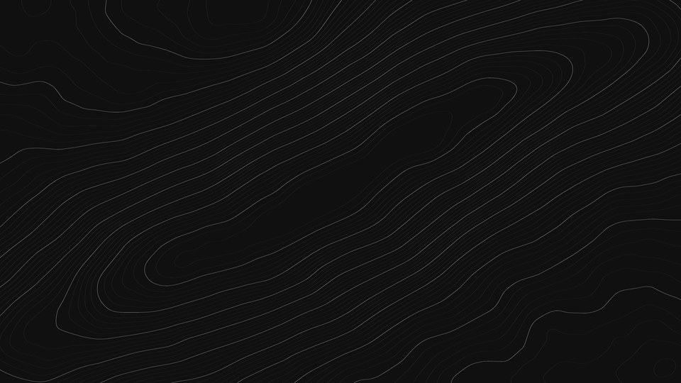
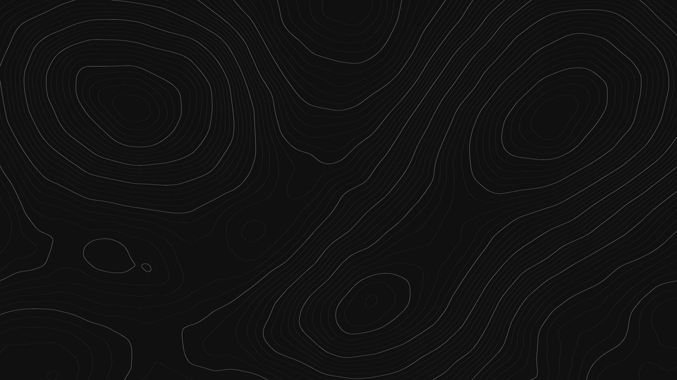
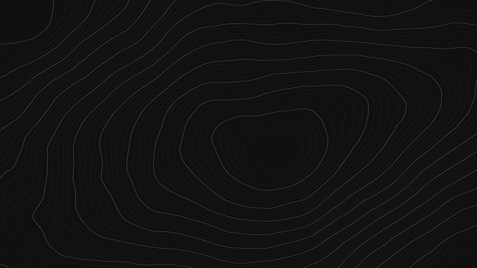

# Topo validation report

**PASS topo validation: 43 checks passed, 0 failed.** Checked offline against Omarchy **`cbd7139ac67b8ef421cf828507ac6f59e02c7c9b`**. Python 3.13.5, NumPy 2.5.5, Pillow 12.3.0.

## Reproduce

```sh
git clone https://github.com/basecamp/omarchy.git ../omarchy
git -C ../omarchy checkout cbd7139ac67b8ef421cf828507ac6f59e02c7c9b
python3 tools/generate_wallpapers.py
python3 tools/generate_previews.py
python3 tools/validate.py --upstream ../omarchy
```

No package installation or network access was used for this run; the supplied local checkout was read only. No git writes, commits, or pushes were performed.

## Backend and limits

The upstream `bin/omarchy-agent-look-theme` ran **unmodified**, using **`tools/magick_shim/magick` (Pillow)** because real ImageMagick was unavailable. It returned **exit 0**, reported **three backgrounds** and **`problems: none`**. The shim computes normalized all-channel image mean and standard deviation; it resizes/crops the first wallpaper to 1280 × 720. It deliberately ignores drawing and text operations, so its output does not validate upstream's drawn desktop layout. The separately generated repository previews are full illustrative Pillow mockups.

Upstream's thresholds are foreground ≥7:1, accent/dark_foreground/red/green/yellow/blue ≥3:1, foreground on selection ≥4.5:1, wallpaper dimensions ≥1920 × 1080, standard deviation ≥0.02, and dark-mode wallpaper mean ≤0.65. This theme additionally enforces all ANSI 1–15 and muted ≥4.5:1, selection foreground and muted on selection ≥4.5:1, inactive border ≥3:1, red/green C* ≥25, cyan C* ≥20 and green/red luminance ≥1.4 for normal and bright pairs. ANSI 0 is the background and is exempt.

Colour readings and copy behavior were verified from the pinned source. A live Hyprland/Plymouth installation or theme switch was not performed. Existing commit metadata was not rewritten; the publishable-file scan excludes git history.

## Wallpaper sizes and reproduction

All wallpapers are 3840 × 2160. Their PNG bytes match the original pre-split assets. Renaming the light files preserves seeds 2704–2706 and their original terrain parameters. SVGs were regenerated with the literal standard namespace; their geometry is unchanged. Preview fonts are resolved using `fc-match`, with a Pillow default fallback; text pixels can differ on another font/library setup.

| Wallpaper | PNG bytes | SVG bytes | JPEG bytes |
| --- | ---: | ---: | ---: |
| [](backgrounds/1-topo-dark-ridge.png) **1-topo-dark-ridge** | 732,383 | 121,522 | 89,909 |
| [](backgrounds/2-topo-dark-peaks.png) **2-topo-dark-peaks** | 835,321 | 137,988 | 85,332 |
| [](backgrounds/3-topo-dark-basin.png) **3-topo-dark-basin** | 713,276 | 118,494 | 85,688 |

| PNG | SHA-256 |
| --- | --- |
| `1-topo-dark-ridge.png` | `74622312c05c075fad584d142f087a41b5f31e79111de597c00cb10059529b4d` |
| `2-topo-dark-peaks.png` | `e9a8f962d16d5a17e766241f7f9ebab1d8510851b4fe9373e305a896241a450e` |
| `3-topo-dark-basin.png` | `b4908e048a316ef1284234a36a6683e6b8af9cdbc20d073d11583a55cedd7823` |

## Contrast

| Role | Colour | Background | Contrast | Minimum |
| --- | --- | --- | ---: | ---: |
| fg | `#dedede` | `#101010` | 14.14:1 | 7:1 |
| muted | `#969696` | `#101010` | 6.43:1 | 4.5:1 |
| accent | `#dedede` | `#101010` | 14.14:1 | 3:1 |
| dark_foreground | `#a4a4a4` | `#101010` | 7.63:1 | 3:1 |
| selection pair | `#f5f5f5` | `#2b2b2b` | 12.99:1 | 4.5:1 |
| foreground on selection | `#dedede` | `#2b2b2b` | 10.52:1 | 4.5:1 |
| muted on selection | `#969696` | `#2b2b2b` | 4.79:1 | 4.5:1 |
| inactive border | `#626262` | `#101010` | 3.12:1 | 3:1 |
| ANSI 1 (red) | `#c27972` | `#101010` | 5.68:1 | 4.5:1 |
| ANSI 2 (green) | `#9cc281` | `#101010` | 9.47:1 | 4.5:1 |
| ANSI 3 (yellow) | `#b9aa77` | `#101010` | 8.23:1 | 4.5:1 |
| ANSI 4 (blue) | `#8da7cc` | `#101010` | 7.73:1 | 4.5:1 |
| ANSI 5 (magenta) | `#b28fbc` | `#101010` | 6.84:1 | 4.5:1 |
| ANSI 6 (cyan) | `#60b4b7` | `#101010` | 7.89:1 | 4.5:1 |
| ANSI 7 (foreground) | `#dedede` | `#101010` | 14.14:1 | 4.5:1 |
| ANSI 8 (muted) | `#969696` | `#101010` | 6.43:1 | 4.5:1 |
| ANSI 9 (bright_red) | `#e49a8f` | `#101010` | 8.44:1 | 4.5:1 |
| ANSI 10 (bright_green) | `#b9e09b` | `#101010` | 12.87:1 | 4.5:1 |
| ANSI 11 (bright_yellow) | `#dccb95` | `#101010` | 11.80:1 | 4.5:1 |
| ANSI 12 (bright_blue) | `#b1caec` | `#101010` | 11.35:1 | 4.5:1 |
| ANSI 13 (bright_magenta) | `#d4b0df` | `#101010` | 10.04:1 | 4.5:1 |
| ANSI 14 (bright_cyan) | `#84d4d6` | `#101010` | 11.21:1 | 4.5:1 |
| ANSI 15 (bright_foreground) | `#f5f5f5` | `#101010` | 17.45:1 | 4.5:1 |

## CIELAB chroma and luminance separation

D65 sRGB, 2° observer. Ratios use green Y / red Y, not WCAG contrast. ΔE76 is informative; no colour-vision simulation is claimed.

| Role | Hex | L* | C* | Minimum C* |
| --- | --- | ---: | ---: | ---: |
| red | `#c27972` | 58.38 | 31.91 | 25 |
| green | `#9cc281` | 74.34 | 37.67 | 25 |
| cyan | `#60b4b7` | 68.42 | 26.37 | 20 |
| bright_red | `#e49a8f` | 70.59 | 31.40 | 25 |
| bright_green | `#b9e09b` | 84.99 | 38.76 | 25 |
| bright_cyan | `#84d4d6` | 80.09 | 25.48 | 20 |
| yellow | `#b9aa77` | 69.75 | 28.37 | — |
| bright_yellow | `#dccb95` | 81.89 | 29.21 | — |
| blue | `#8da7cc` | 67.77 | 21.79 | — |
| bright_blue | `#b1caec` | 80.54 | 19.59 | — |
| magenta | `#b28fbc` | 63.95 | 28.16 | — |
| bright_magenta | `#d4b0df` | 76.30 | 28.36 | — |
| orange | `#c29c72` | 66.87 | 28.61 | — |
| brown | `#a78973` | 59.29 | 17.99 | — |

| Pair | Green / red relative luminance | Minimum |
| --- | ---: | ---: |
| normal | 1.792 | 1.4 |
| bright | 1.587 | 1.4 |

| Pair | ΔE76 |
| --- | ---: |
| red / bright_red | 12.34 |
| green / bright_green | 10.71 |
| yellow / bright_yellow | 12.17 |
| blue / bright_blue | 12.98 |
| magenta / bright_magenta | 12.35 |
| cyan / bright_cyan | 11.71 |
| orange / brown | 13.57 |

## Judgment calls

- Neutral graphite surfaces are preserved; red is warmer and darker than green. The selection surface is darkened to keep muted text readable.
- The inactive border remains because upstream consumes it. Its contrast is 3.12:1. Derived icon marks and unused/redundant overrides are removed.
- The light artwork lives only in the separate light theme. Each generator contains only its own three designs; the fixed seeds and algorithm preserve artwork.
- Source, preview and tool directories remain ordinary directories. Upstream copies their 742,125 bytes (about 0.74 MB) on every switch; see [installed size](README.md#installed-size) for exact source lines.
- The only hostname exceptions are the exact W3C SVG namespace, and the two approved GitHub owner/repository prefixes in documentation. The pattern scan cannot certify historical git metadata.

## Complete validator output

```text
topo validation (offline)

PASS publishable files are regular files
PASS upstream HEAD matches pinned cbd7139ac67b8ef421cf828507ac6f59e02c7c9b
PASS parsed upstream INSTALLED_THEME_DENIED: alacritty.toml, foot.ini, ghostty.conf, kitty.conf, vscode.json
INFO All top-level *.lua files are also denied; upstream recursively copies other non-symlink entries, including source, previews and tools.
PASS denied top-level files absent
PASS bundled upstream themes discovered: 23
Bundled themes: catppuccin, catppuccin-latte, ethereal, everforest, flexoki-light, gruvbox, hackerman, jade-horse, kanagawa, last-horizon, lumon, lupine, matte-black, miasma, nord, retro-82, ristretto, rose-pine, solitude, starship, tokyo-night, vantablack, white

Bundled upstream inventory (observation, not a copy allowlist):
| File | Bundles | Requirement | topo |
| --- | ---: | --- | --- |
| btop.theme | 4/23 | optional | absent |
| chromium.theme | 5/23 | optional | present |
| colors.toml | 23/23 | required | present |
| keyboard.rgb | 2/23 | optional | absent |
| preview-unlock.png | 22/23 | optional | present |
| preview.png | 23/23 | required | present |
| shell.lock.toml | 1/23 | optional | absent |
| unlock.png | 22/23 | optional | present |
PASS all universally bundled non-denied files present
Dropped upstream files (excluded from requirements):
  hyprland.lua: 5/23 bundles; prohibited
  neovim.lua: 14/23 bundles; prohibited
  vscode.json: 15/23 bundles; prohibited
INFO The starship bundle lacks unlock and unlock-preview assets; this validator checks those separately below.
PASS configuration syntax checked: 1 .toml, 0 .css, 0 .ini
PASS colors.toml parsed
PASS palette includes all 27 supported bundled-theme keys and explicit selection roles
PASS dead, redundant, and derived palette overrides absent
PASS every palette color is #rrggbb
PASS palette mode = "dark"
PASS chromium.theme contains one RGB triplet
PASS chromium.theme matches background RGB
PASS contrast uses upstream omarchy-theme-color --all (resolved ANSI, fg, bg, muted)

| Role | Foreground | Background | Contrast | Minimum | Result |
| --- | --- | --- | ---: | ---: | --- |
| fg | #dedede | #101010 | 14.14:1 | 7.0:1 | PASS |
| muted | #969696 | #101010 | 6.43:1 | 4.5:1 | PASS |
| selection fg | #f5f5f5 | #2b2b2b | 12.99:1 | 4.5:1 | PASS |
| fg on selection | #dedede | #2b2b2b | 10.52:1 | 4.5:1 | PASS |
| muted on selection | #969696 | #2b2b2b | 4.79:1 | 4.5:1 | PASS |
| accent | #dedede | #101010 | 14.14:1 | 3.0:1 | PASS |
| dark_foreground | #a4a4a4 | #101010 | 7.63:1 | 3.0:1 | PASS |
| inactive border | #626262 | #101010 | 3.12:1 | 3.0:1 | PASS |
| ANSI 0 (background) | #101010 | #101010 | n/a | n/a | background |
| ANSI 1 (red) | #c27972 | #101010 | 5.68:1 | 4.5:1 | PASS |
| ANSI 2 (green) | #9cc281 | #101010 | 9.47:1 | 4.5:1 | PASS |
| ANSI 3 (yellow) | #b9aa77 | #101010 | 8.23:1 | 4.5:1 | PASS |
| ANSI 4 (blue) | #8da7cc | #101010 | 7.73:1 | 4.5:1 | PASS |
| ANSI 5 (magenta) | #b28fbc | #101010 | 6.84:1 | 4.5:1 | PASS |
| ANSI 6 (cyan) | #60b4b7 | #101010 | 7.89:1 | 4.5:1 | PASS |
| ANSI 7 (foreground) | #dedede | #101010 | 14.14:1 | 4.5:1 | PASS |
| ANSI 8 (muted) | #969696 | #101010 | 6.43:1 | 4.5:1 | PASS |
| ANSI 9 (bright_red) | #e49a8f | #101010 | 8.44:1 | 4.5:1 | PASS |
| ANSI 10 (bright_green) | #b9e09b | #101010 | 12.87:1 | 4.5:1 | PASS |
| ANSI 11 (bright_yellow) | #dccb95 | #101010 | 11.80:1 | 4.5:1 | PASS |
| ANSI 12 (bright_blue) | #b1caec | #101010 | 11.35:1 | 4.5:1 | PASS |
| ANSI 13 (bright_magenta) | #d4b0df | #101010 | 10.04:1 | 4.5:1 | PASS |
| ANSI 14 (bright_cyan) | #84d4d6 | #101010 | 11.21:1 | 4.5:1 | PASS |
| ANSI 15 (bright_foreground) | #f5f5f5 | #101010 | 17.45:1 | 4.5:1 | PASS |
PASS contrast thresholds: fg 7:1; muted, selection text and ANSI 1–15 4.5:1; accent, dark_foreground and inactive border 3:1

CIELAB D65 chroma and relative luminance:
| Role | Hex | L* | C* | Relative luminance | Minimum C* | Result |
| --- | --- | ---: | ---: | ---: | ---: | --- |
| red | #c27972 | 58.38 | 31.91 | 0.2636 | 25 | PASS |
| green | #9cc281 | 74.34 | 37.67 | 0.4724 | 25 | PASS |
| cyan | #60b4b7 | 68.42 | 26.37 | 0.3855 | 20 | PASS |
| yellow | #b9aa77 | 69.75 | 28.37 | 0.4040 | diagnostic | PASS |
| blue | #8da7cc | 67.77 | 21.79 | 0.3766 | diagnostic | PASS |
| magenta | #b28fbc | 63.95 | 28.16 | 0.3274 | diagnostic | PASS |
| bright_red | #e49a8f | 70.59 | 31.40 | 0.4159 | 25 | PASS |
| bright_green | #b9e09b | 84.99 | 38.76 | 0.6599 | 25 | PASS |
| bright_cyan | #84d4d6 | 80.09 | 25.48 | 0.5685 | 20 | PASS |
| bright_yellow | #dccb95 | 81.89 | 29.21 | 0.6010 | diagnostic | PASS |
| bright_blue | #b1caec | 80.54 | 19.59 | 0.5764 | diagnostic | PASS |
| bright_magenta | #d4b0df | 76.30 | 28.36 | 0.5038 | diagnostic | PASS |
| orange | #c29c72 | 66.87 | 28.61 | 0.3646 | diagnostic | PASS |
| brown | #a78973 | 59.29 | 17.99 | 0.2734 | diagnostic | PASS |
PASS red/green C* >=25 and cyan C* >=20, normal and bright

| Red/green pair | Green / red luminance | Minimum | Result |
| --- | ---: | ---: | --- |
| normal | 1.792 | 1.4 | PASS |
| bright | 1.587 | 1.4 | PASS |
PASS normal red/green luminance separation >= 1.4
PASS bright red/green luminance separation >= 1.4

| Distinctness diagnostic | Delta E76 |
| --- | ---: |
| red / bright_red | 12.34 |
| green / bright_green | 10.71 |
| yellow / bright_yellow | 12.17 |
| blue / bright_blue | 12.98 |
| magenta / bright_magenta | 12.35 |
| cyan / bright_cyan | 11.71 |
| orange / brown | 13.57 |
PASS retained hyprland_inactive_border is consumed by upstream template
PASS exactly three dark wallpapers present: 3
PASS backgrounds/1-topo-dark-ridge.png: 3840x2160, 732,383 bytes (minimum 4K, below 5 MB)
INFO backgrounds/1-topo-dark-ridge.png: normalized RGB mean 0.072599, standard deviation 0.053660
PASS matching source src/1-topo-dark-ridge.svg
PASS previews/1-topo-dark-ridge.jpg: 960x540 (expected 960x540)
PASS backgrounds/2-topo-dark-peaks.png: 3840x2160, 835,321 bytes (minimum 4K, below 5 MB)
INFO backgrounds/2-topo-dark-peaks.png: normalized RGB mean 0.071220, standard deviation 0.049846
PASS matching source src/2-topo-dark-peaks.svg
PASS previews/2-topo-dark-peaks.jpg: 960x540 (expected 960x540)
PASS backgrounds/3-topo-dark-basin.png: 3840x2160, 713,276 bytes (minimum 4K, below 5 MB)
INFO backgrounds/3-topo-dark-basin.png: normalized RGB mean 0.071614, standard deviation 0.050896
PASS matching source src/3-topo-dark-basin.svg
PASS previews/3-topo-dark-basin.jpg: 960x540 (expected 960x540)
PASS exactly three matching SVG sources present: 3
PASS exactly three matching JPG thumbnails present: 3
PASS SVG XML parsed: src/1-topo-dark-ridge.svg (121,522 bytes)
PASS SVG XML parsed: src/2-topo-dark-peaks.svg (137,988 bytes)
PASS SVG XML parsed: src/3-topo-dark-basin.svg (118,494 bytes)
PASS preview.png: 2560x1440 (expected 2560x1440)
PASS preview-unlock.png: 1920x1080 (expected 1920x1080)
PASS previews/palette.png: 960x540 (expected 960x540)
PASS unlock.png: 800x188 RGBA, transparent background
PASS Pillow magick shim is executable
INFO look-check magick: Pillow shim (tools/magick_shim/magick); RGB image statistics and background crop only; drawing operations ignored.

Upstream look-check output:
screenshot: <tempfile>
backgrounds: 3 (1-topo-dark-ridge.png, 2-topo-dark-peaks.png, 3-topo-dark-basin.png)
problems: none
PASS unmodified upstream look check: exit 0, problems: none
PASS upstream look-check output image: 1280x720
PASS privacy scan of 23 publishable files: no email, unapproved hostname, or absolute machine path
INFO Privacy scope: filenames, text, Python comments/string literals, and decoded image metadata; excludes git/environment/cache metadata and recognized file suffixes. URL exceptions: exact W3C SVG namespace; GitHub owner and upstream repository links in Markdown docs only.

PASS topo validation: 43 checks passed, 0 failed.
```
